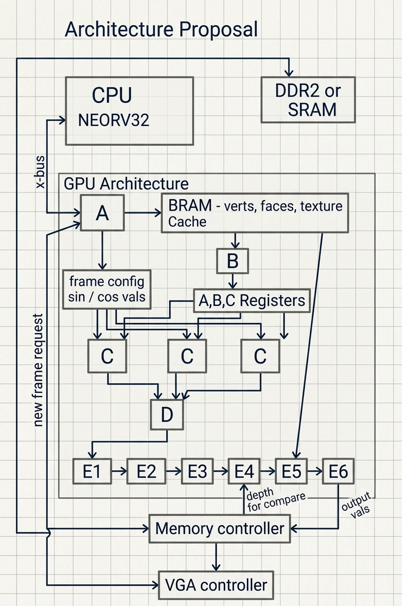

# Initial Architecture Proposal

**Team 05 – QOGPU Graphics Pipeline**

Connor Bodie

10/20/2026

The following is an outline of our initial proposed architecture for the hardware renderer.

## Block Diagram

## CPU responsibilities

The NEORV32 softcore will serve as the system's CPU, and will have the following responsibilities:

- Initialize data (Normalize_Mesh() function in Ada Renderer)
- Send Vertex array, face-index array and texture arrays to the GPU via NEORV’s X-bus
- For each desired frame:
  - Send sin and cos values for each rotation axis angle (6 values)
  - Send a “Draw” command, which will prompt the GPU to clear the depth and frame buffers
  - Wait for a response from the GPU (“Busy”, “Done”, “Error” encodings)

## GPU structure and responsibilities

Our custom GPU hardware will have the following structure and responsibilities:

### Sub-block “A”: Command and local storage controller

- Accept data structures through X-bus
- Store them in local BRAM cache
- Accept per-frame parameters (sin and cos, “draw”)
- Send request to memory controller to clear the buffers
- Manage sequential triangle processing
- Report “Busy”, “Done”, “Error”

### Block E: Fetch face data; Vertex assembly

- For each triangle:
  - Read 3 vertex indices
  - Fetch actual 16.16 coordinate values
  - Store coordinate values into 9 input registers (Ax, Ay, Az, Bx, By …)
  - Start 3 transform blocks in parallel

### Block C: Three vertex-transform blocks

- Each C block takes the three coordinate values for one vertex and performs:
  - 3-axis rotation
  - Resolution scaling + offset
  - Depth range mapping

### Block D: Triangle setup

- Receives rotated and scaled coordinate values for all three vertices of the active face
- Calculates the bounding box values (min/max x/y)
- Calculate the signed triangle area function
- Reject zero-area triangles

### E Blocks: Pixel pipeline

- This is where we transition from vertex-level operations to pixel-level operations:
  - E1: Generate X,Y coordinates within the bounding box
  - E2: Evaluate α, β, γ Values
  - E3: Calculate pixel depth and UV texture mapping coordinate values
  - E4: Compare depth to depth buffer / reject covered pixels
  - E5: Read color from texture (U, V), and apply shading
  - E6: Write back winning color and depth

### Memory Controller

- Interface blocks E4 and E6 with DDR2 or SRAM bulk memory for depth and frame buffer read and write operations
